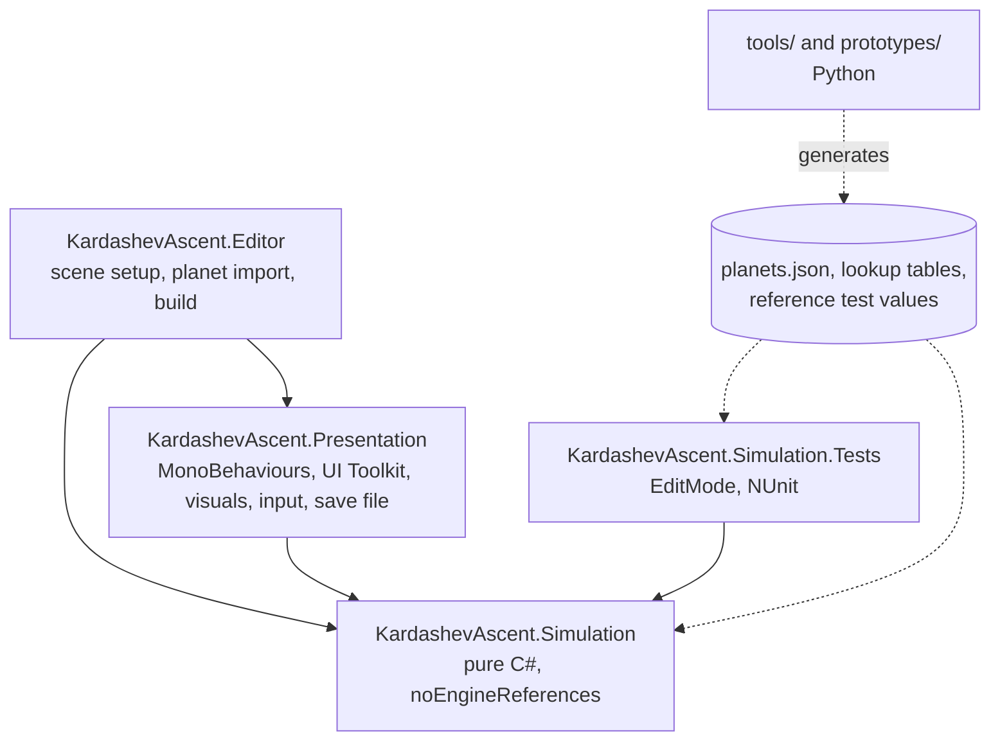
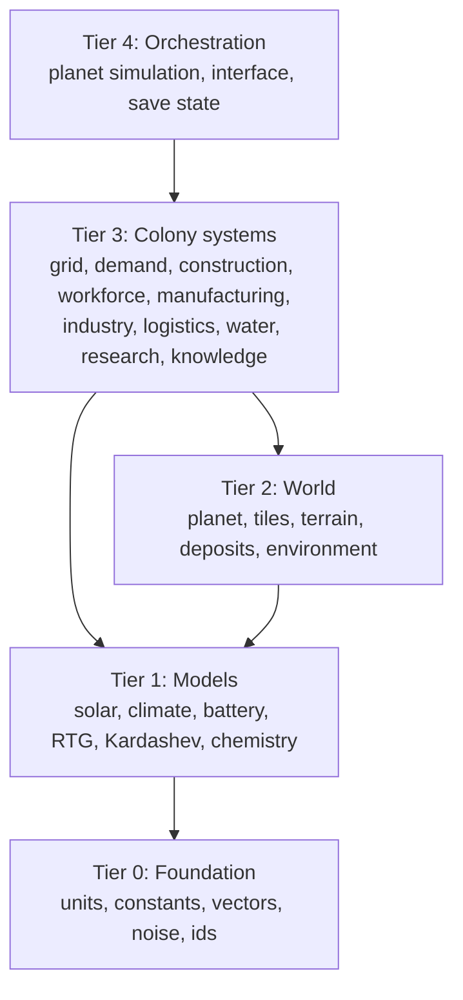

# System architecture

How the code is organised today, the rules a change must keep, the shape the architecture should grow into, and the order in which to get there.

Sections 1–3 describe `main` as audited on 2026-11-12 ([`../development/repository-audit.md`](../development/repository-audit.md)). Sections 4–6 are the target and are **proposals** until each migration step is done; none of them has been applied to code.

The contract between the two layers, with coordinate and unit conventions, is [`../simulation-interface.md`](../simulation-interface.md) (Thai).

## 1. Layers and assemblies

| Layer | Folder | May reference | Must not |
| --- | --- | --- | --- |
| Simulation | `Assets/_Project/Scripts/Simulation` | .NET only | Reference `UnityEngine`, Presentation or files on disk; use `float` for physical quantities; read the clock or unseeded randomness |
| Presentation | `Assets/_Project/Scripts/Presentation` | Simulation, Unity | Hold game rules or game state; change simulation state except through commands |
| Editor | `Assets/_Project/Scripts/Editor` | Both | Be needed at runtime |
| Tests | `Assets/_Project/Tests/EditMode` | Simulation | Reference Presentation |

The compiler enforces the first row: the Simulation assembly has `noEngineReferences` set and an empty reference list.

Four assemblies are enough today. Do not add an assembly for a category (data, persistence, infrastructure) that has only a handful of files; section 6 says when a split becomes worth it.

## 2. Simulation modules as built

| Namespace | Role | Depends on |
| --- | --- | --- |
| `Solar` | Light from star to panel: orbit, sun position, atmosphere, panel, yield, spectra, sky knowledge | `Planet` (one file) |
| `Climate` | Cloud factor, waste heat | — |
| `Energy` | Battery, RTG, power grid, colony demand | — |
| `Civilization` | Kardashev mathematics | — |
| `Planet` | Hex sphere, terrain, building slots, planet records | `Solar`, `Resources`, `Civilization` |
| `Resources` | Materials, deposits, material stock | `Planet` |
| `Robots` | Robots, groups, tasks, scheduling, upkeep, movement, manufacturing | `Energy`, `Planet`, `Resources`, `Game` |
| `Game` | The interface, the orchestrator, construction, save state, panel tiers, history | all of the above |

How the pieces run:

- `Game/IPlanetSimulation.cs` is the only door between layers: properties to read, commands that return `bool` or a reason string, and C# events.
- `Game/StubPlanetSimulation.cs` is the only implementation. It owns one instance of each system and calls them in a fixed order inside `Step`.
- `Tick(hours)` cuts time into sub-steps of at most 0.25 h. Presentation calls `Tick` once per frame from `SimulationRunner`.
- Systems do not hold references to each other. The orchestrator passes each one what it needs every step. Mostly these are values: the grid receives the robots' charging request as watts and returns what was served. In two cases it is an object: robot upkeep is handed the construction queue and the material stock. Values are the pattern to keep.

The order inside one sub-step is documented in [`system-interactions.md`](system-interactions.md), section 3.

## 3. Presentation, persistence and data as built

- **Host.** `SimulationRunner` builds the simulation for a `PlanetDNA` asset and raises `SimulationCreated`; views subscribe and re-read.
- **Views.** One MonoBehaviour per panel or visual, each holding a UI Toolkit document or scene objects. Views poll the interface and listen to its events.
- **Scene.** `Editor/MainSceneSetup.cs` creates and wires every object. Scene and prefab files are never edited as text.
- **Persistence.** `IPlanetSimulation.CaptureState()` returns a `SimulationState` (plain serialisable classes, version 16). `SaveGameController` writes it as JSON with `JsonUtility`. `RestoreState` fills missing fields of older versions with defaults.
- **Data.** Planets are the only content in data files; see [`data-architecture.md`](data-architecture.md).

## 4. Architecture rules

These hold for every change. Rules 1–6 describe what the code already does; rules 7–10 are new and apply to new code.

1. **Simulation knows nothing about Unity or the screen.** A feature that needs a new fact on screen adds a read-only member to the interface.
2. **Presentation holds no rules.** If a view computes a game quantity, the computation belongs in Simulation with a test.
3. **One door.** Presentation reaches simulation state only through the interface.
4. **Commands answer.** A command returns `bool`, or `null` for success and a reason string for failure. It changes nothing when it fails.
5. **Systems meet in the orchestrator.** A system takes its inputs as values and returns its results as values. It does not hold a reference to another system.
6. **Every state change is saveable.** New state goes into `SimulationState` with a version bump and a migration test in the same change.
7. **Dependencies point down the tiers** of section 5. No new namespace cycle.
8. **Read models, not live objects.** New interface members return values, structs or read-only views. They do not hand Presentation a mutable simulation object.
9. **Physical flows are ledgers.** Energy moves in Wh and W, matter in kg. A system that produces or consumes either reports the amounts, so that balances can be tested.
10. **Known is not actual.** New player-facing information is modelled as what the colony has observed ([`information-architecture.md`](information-architecture.md)), not as a direct read of the truth.

## 5. Target structure (proposed)

The target keeps the two layers and the single door. It adds order inside Simulation so that the systems of the vision have a place to go.

### 5.1 Tiers inside Simulation

| Tier | Contains | Character |
| --- | --- | --- |
| 0 Foundation | Constants, `Double3`, noise, shared ids | No game meaning |
| 1 Models | Physics and chemistry as functions of their inputs | Stateless; each formula sourced and tested |
| 2 World | What a planet is: geometry, terrain, deposits, environment fields | Built once per planet from a record and a seed |
| 3 Colony systems | What the colony has and does | Stateful; stepped with values in, values out; saveable |
| 4 Orchestration | Step order, wiring, the interface, save and restore | No formulas, no balance numbers |

A lower tier never references a higher one. Two systems in tier 3 do not reference each other.

### 5.2 Where the vision's systems go

Only the first column of "exists" is built. The rest names a home so that two developers do not create two. No mechanics are implied.

| System group | Namespace | Tier | Exists | First contract it needs |
| --- | --- | --- | --- | --- |
| Planet geometry, terrain, records | `Planet` | 2 | Yes | — |
| Environment: atmosphere, climate, temperature, pressure | `Environment` (new; `Climate` models stay in tier 1) | 2 | No | A per-tile, per-time query that other systems read |
| Geology and deposits | `Resources` | 2 | Yes | Deposit amounts, so that mining can deplete |
| Energy generation models | `Solar`, later one namespace per source family | 1 | Solar | Each source reports power as a function of world state |
| Power grid, storage, distribution | `Energy` | 3 | One bus | Named loads and sources with priorities, instead of fixed arguments |
| Thermal management | `Energy` or `Thermal` (decide when designed) | 3 | Waste-heat model only | A heat ledger beside the electricity ledger |
| Construction and buildings | `Buildings` (today in `Game`) | 3 | Yes | A building definition table |
| Robotic workforce | `Robots` | 3 | Yes | — |
| Colony network, robot AI, knowledge sync | `Robots` | 3 | Unmerged | — |
| Materials, storage, logistics | `Resources` (stock), `Logistics` (new) | 3 | Stock only | Inventories per place; transfers as tasks |
| Industry and chemical processing | `Industry` (new) | 3 | Workshop jobs; local uncommitted work | Recipes with mass and energy balance |
| Water infrastructure | `Water` (new), built on `Industry` and `Logistics` | 3 | No | Water as a material with flows |
| Research, experiments, discoveries | `Research` (new) | 3 | Sky notebook only | Observations in, knowledge and unlocks out |
| Reports and colony knowledge | `Knowledge` (new) | 3 | No | The observation record of the information architecture |
| Progression and technology | `Civilization` | 3 | Milestones | One unlock table |
| Events and hazards | `Events` (new) | 3 | Flare wear only | Scheduled, seeded occurrences that systems read |
| Several colonies and planets, interplanetary transport | Above the planet simulation | 4 | No | A civilization object that owns planet simulations |
| AI scientific assistant | Presentation or a new integration layer; reads `Knowledge` only | — | No | Controlled read access; never raw simulation state |

### 5.3 Categories the director asked about

| Category | Decision |
| --- | --- |
| Simulation, Presentation | Keep as the two layers |
| Domain models | Not a separate layer. The domain lives in Simulation tiers 1–3 |
| Data and configuration | Record types in Simulation, files under `Assets/_Project/Data`, loading in Editor or Presentation ([`data-architecture.md`](data-architecture.md)) |
| Persistence | State classes in Simulation, file handling in Presentation. A separate assembly only when a second storage target appears |
| Infrastructure | Editor tools and `tools/`. No runtime infrastructure layer is needed yet |
| AI integration | Not built. When it is, it sits outside Simulation and reads the knowledge model |
| User interface, visualisation | Both in Presentation; keep `UI/` and `Planet/` apart as today |
| Testing | One EditMode assembly now; see [`../development/testing-standards.md`](../development/testing-standards.md) |

## 6. Migration plan

Each step keeps behaviour and saves unchanged and passes the whole test suite. Steps are ordered by what they unblock. None is urgent enough to interrupt feature work in flight; do each when the branches that touch the same files have merged.

| Step | Change | Why | Risk |
| --- | --- | --- | --- |
| M1 | Split `StubPlanetSimulation` into partial files by system, then move each system's bookkeeping into its own class stepped by the orchestrator | The class grows with every feature; workforce plan risk R2 and stage H | Merge conflicts with open branches: do it between features |
| M2 | Rename the class to `PlanetSimulation` | The name "stub" misleads new readers | A rename touches every test; do it in the same window as M1 |
| M3 | Break the three namespace cycles: move `PlanetChemistry` to `Planet`, Earth constants to a shared constants class, and the `Game` types that `Robots` needs into `Robots` or a lower namespace | Lets tiers be checked and assemblies be split later | Low |
| M4 | Group the interface into role interfaces (`IEnergyReadout`, `IConstructionCommands`, …) that `IPlanetSimulation` inherits | Views depend on what they use; the door stays single | None: additive |
| M5 | Replace live objects on the interface (`Workforce`, `DepositMap`, `MaterialStock`) with read models and commands | Rule 8; needed before "known versus actual" can be enforced | Medium: Presentation code changes |
| M6 | One unlock table; one robot data catalogue; a building definition table | Removes the duplication found by the audit; prepares data files | Low |
| M7 | Named loads and sources on the power grid | Every new consumer otherwise adds an argument to `PowerGrid.Step` | Medium: balance must stay identical |
| M8 | Add energy and mass ledger tests | Rule 9 has no test today | None |
| M9 | A civilization object above planet simulations, with its own save envelope | Needed only when a second colony or planet runs at once | High: design first (OQ-2) |

A further split of the Simulation assembly (models apart from game systems) is worth doing only when compile time hurts or when a second program needs the models alone. It depends on M3.

## 7. Adding a system

1. Read its row in section 5.2 and its entries in the feature registry.
2. Write or update its specification in `docs/design/`.
3. Put formulas in tier 1 with sources and tests before any game code uses them.
4. Put state in a tier 3 class with `Step`, `Capture` and `Restore`.
5. Wire it in the orchestrator; add interface members as read models and commands.
6. Bump the save version with a migration test.
7. Add the view through `MainSceneSetup`.
8. Update the registry, the interactions document and the interface document.
