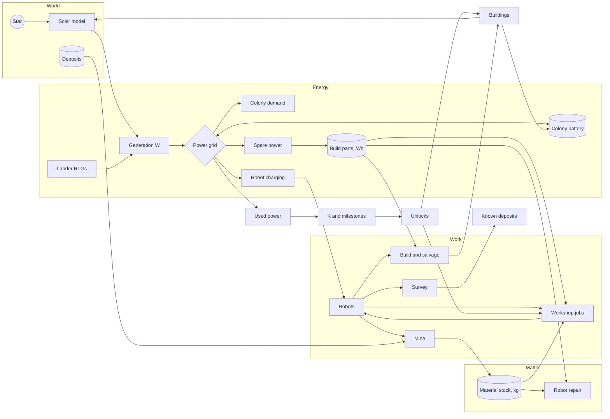

# System interactions

What flows between systems, in what order, and through which contracts. Read [`system-architecture.md`](system-architecture.md) first.

Sections 1–4 describe `main` as audited on 2026-11-12. Section 5 lists the contracts that future systems need; those are proposals.

## 1. Three kinds of flow

| Flow | Unit | Carried as | Rule |
| --- | --- | --- | --- |
| Energy | W for rates, Wh for amounts | Numbers passed through the orchestrator | Every watt generated is served, stored, turned into parts, used by robots or curtailed |
| Matter | kg | The material stock; recipes | Matter enters from the ground and leaves only into products |
| Information | Events, read-only members, survey and notebook state | The interface | The player and the robots act on what has been observed |

A fourth flow, **work**, links them: robot hours turn energy and matter into buildings, surveys, ore and products.

## 2. Flow map as built

## 3. Order inside one sub-step

`PlanetSimulation.Step(dt)`, with `dt` at most 0.25 h. The order is part of the game's behaviour: changing it changes results and must be treated as a design change with tests.

| # | Action | Reads | Writes |
| --- | --- | --- | --- |
| 1 | Advance time; update the star's direction | Planet orbit | Time, star direction |
| 2 | Robot upkeep plans charging | Robots, charging facilities, movement | Three power requests: dock (lander), critical (below 20 %), top-up |
| 3 | Power grid step | Generation from panels and RTGs, colony demand, dock and critical requests | Served power, battery, curtailed power, brownout event |
| 4 | Split spare power | Curtailed power, top-up request | Top-up for robots first; the rest becomes build-part power |
| 5 | Robot upkeep applies | Power served to robots, flares, air temperature, build parts, materials | Robot charge, battery health, condition, repairs |
| 6 | Field work advances | Robots at work | Survey progress, mined kg, Workshop job hours |
| 7 | Build parts added | Build-part power | Parts stock |
| 7a | **Rules evaluate** (new, mission operations P3, MO-12) | The known state of each robot and plant (own readings; the colony's values only while on the network), the rulebook version each one runs | Overrides on robots, plant commands, stock targets and haul requests, Operations log entries; robots and plants sync to the newest rulebook version. With no rulebook published, nothing changes |
| 7b | Hauls are planned (mission operations P1b) | Site shortfalls, stock targets, plants waiting for input, what each depot holds | New haul orders (the planner folds them into the open tasks of step 8) |
| 8 | Work is settled | Parts, sites, open tasks (haul stops included), robot settings | Sites paid and finished, tasks assigned, building events |
| 9 | Used power and milestones | Served, charged, parts and robot power | K, day average, milestone events at the end of a day |
| 10 | Colony demand step | Generation, served power, brownout | Demand for the next step |
| 11 | History sample | Step results | Power history |
| 12 | Day or night at the base | Sun altitude | Day-night event |

Consequences worth knowing:

- Robots charge before the colony's battery fills, and build parts are made only from what is left after both.
- Colony demand reacts one step late, by design: it reads this step's result and sets the next step's demand.
- Events fire inside `Tick`. A listener must not call a command that ticks the simulation.

## 4. Contracts as built

| Between | Contract | Type |
| --- | --- | --- |
| Presentation → Simulation | `Tick`, placement, order and settings commands | `IPlanetSimulation` |
| Simulation → Presentation | Properties, `OpenWork()`, `CaptureState()`, seven events | `IPlanetSimulation` |
| Solar model → grid | Watts from all finished panels | `double` |
| Robots → grid | Dock, critical and top-up requests, W | `RobotUpkeep.Plan` results |
| Grid → everyone | `GridStep` (served, charged, discharged, curtailed, per-load served) | `readonly struct` |
| Orchestrator → robots | The list of open tasks, colony needs, movement data | `WorkTask`, `ColonyNeeds`, `Movement` |
| Robots → orchestrator | Who works on what; assignment changes with reasons | `Workforce.WorkersOf`, `Changes` |
| Construction ↔ robots | A site takes parts only while a robot works on it | Checked in the orchestrator |
| Survey → knowledge | A surveyed tile's deposits become visible | `DepositMap.IsSurveyed`, `TileSurveyed` event |
| Milestones → unlocks | Milestone count gates tiers, robot kinds, modules, refining, group capacity | `PanelTiers`, `RobotTech`, `RobotCatalog` |
| Planet record → everything | Solar parameters, chemistry, flags, look | `PlanetRecord` conversion methods |
| Mining, hauls → depots | Mined ore into the mine tile's pile; a haul moves kg between depots through the robot's cargo place | `InventoryBook` (`Logistics`) |
| Depots → construction | A site draws only from its own tile's depot | `Construction.Pay(stockFor, ...)` |
| Demand → hauls | Site shortfalls, stock targets, plants waiting for input, matched with the nearest holding by route hours | `HaulPlanner.Plan` (pure) |
| Haul → robots | Load and unload stops as `TaskKind.Haul` tasks; cargo raises the drive power | `RobotUpkeep.CargoKgOf`, `Movement.DrivePowerWithCargoW` |
| Depot ↔ plant | A same-tile conveyor fills the input buffer and empties the output buffer | `PlanetSimulation.Plants` |
| Plant → air or tank | Gas goes to the output buffer then a gas tank (store) or is vented and logged | `ByproductPolicy`, `VentedKg` |
| Plant → heat readout | Waste heat of each batch | `IndustrialWasteHeatW`, `WasteHeat.ForcingWm2` (readout only) |
| Known state → rules | Each robot's and plant's own readings, and the colony's values only while on the network | `KnownState` |
| Rulebook → robots and plants | The version the network synced; overrides, plant commands, hauls | `Rulebook`, `SyncedRulebookVersion`, step 7a |
| Everything → Operations log | Rule firings, syncs, notices, in the observation-record shape | `OperationsLog` |
| Ledgers → Flowsheet view | The last week of mass flows as a value | `FlowsheetSnapshot` |
| Save | Whole state out and in | `SimulationState` |

## 5. Contracts the future systems need (proposed)

Each row is a question to answer in that system's specification, not a design.

| Interaction from the vision | Missing contract today |
| --- | --- |
| Mining produces physical materials | Deposit amounts and depletion; purity of what is mined |
| Logistics transports materials | Inventories per place (tile, building, robot) instead of one stock; a transfer task |
| Storage maintains inventories | Capacity and storage class per place |
| Factories consume materials; manufacturing creates components | A recipe type with inputs, outputs, byproducts, electricity, heat and time; a facility that runs it |
| Robots operate and maintain facilities | Facility staffing exists; maintenance of facilities does not |
| Energy systems provide electricity and thermal services | Named loads and sources on the grid; a heat ledger |
| Environment affects production and equipment | An environment query per tile and time (temperature, pressure, dust, radiation) |
| Research unlocks understanding and technology | Observations as inputs; a single unlock table as output |
| Reports communicate changes | An observation and report record ([`information-architecture.md`](information-architecture.md)) |
| AI assists interpretation and planning | Read access to the knowledge model only |
| Interplanetary logistics connects economies | A civilization object; shipments between planet simulations; a shared clock |

## 6. Rules for interactions

1. A new flow is energy, matter, information or work. If it is none of these, question it.
2. A producer reports amounts; a consumer requests amounts; the orchestrator decides who is served when there is not enough, in a documented priority order.
3. No system reads another system's private state. If it needs a number, the number goes on a result struct.
4. An interaction that crosses planets goes through the civilization object, never from one planet simulation to another.
5. A new interaction adds a row to section 4 of this document in the same pull request.
