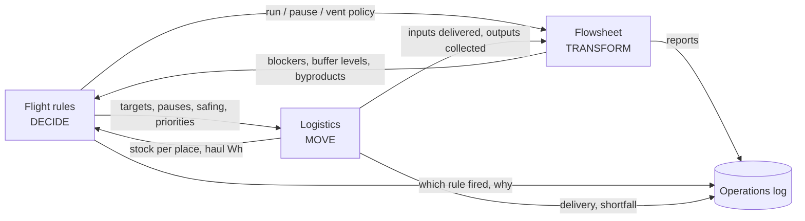

# Mission operations: flight rules, logistics, flowsheet

Status: shape CONFIRMED by the director on 2026-11-20 (through the brief `kardashev-mission-operations-prompt.md`). Every number stays PROPOSED / TBD until it is sourced or the director approves it as a game rule.
Registry entries: MO-01 to MO-15 (new), and RS-06, RS-08, RS-09, RB-14, OQ-10 (updated).

## 1. Purpose

The colony today runs on one magic stockpile that every robot reaches instantly, and on two refinery recipes that throw their gases away. This system replaces both with three parts that feed each other, the colony's operations workflow:

- **Flight rules (DECIDE).** A versioned rulebook of pre-approved decisions, synced over the colony network.
- **Logistics (MOVE).** Inventories per place, haul tasks, and the energy of hauling.
- **Flowsheet (TRANSFORM).** Unit operations with a mass, energy and heat balance.

Why it belongs to this game. Planets are real: Proxima Centauri b is 1.30 pc away, about 4.24 light-years, so a question sent to Earth is answered in about 8.5 years. A real expedition cannot be run from Earth, and cannot be run by clicking every robot. It runs on pre-approved decisions, as real missions do: NASA flight rules (each decision written down with its rationale), spacecraft fault protection and safe mode, and Mars rover operations (a day's sequence uplinked, executed alone, reported back).

Pillars served: 1 (real science), 2 (few, clear commands), 3, 4, 5, 6, 7, 8 (known versus actual), 9 (failure explains itself). The identity test of the vision ("a copy is not justified") is features U1 to U8 in section 3.1.

## 2. What exists today

Checked against `main` at `77cfce1` (save version 37).

| Need | Existing code | Plan |
| --- | --- | --- |
| Colony stock | `Resources/DepositMap.cs`, `MaterialStock` (one array, kg) | Stays as a facade: the sum over every place the colony knows about. Real holdings move into inventories (P1) |
| Stores, classes | `Resources/IndustrialProduction.cs`: `MaterialStorage`, `StorageClass`, `MaterialPhase`, `MaterialCatalog`, `MaterialAmount` | Wired into depots and plant buffers (this is RS-06 / OQ-10, built as a library and never wired). Extend `MaterialCatalog`; no second catalogue |
| Processes, blockers | `IndustrialProcess`, `IndustrialProcessor.TryRun`, `IndustrialBlocker`, `IndustrialReportLog` | The flowsheet runs on these. `TryRun` takes an input store instead of `MaterialStock` |
| Refining | `Resources/Refining.cs` (`RefineRecipe`, slag, `VentedKg`), `Game/PlanetSimulation.Refining.cs` (modules, queue, `autoTargets`) | Each `RefineRecipe` becomes an `IndustrialProcess` with named byproducts. Auto refine becomes a stock target; the old command stays as a wrapper |
| Tasks | `Robots/WorkTask.cs` (`TaskKind`), `TaskBook`, `TaskPolicy`, `RobotAbilities.TieRank` | Append `TaskKind.Haul` at the end |
| Transport robot | `RobotKind.Transport`, `RobotCatalog` (`TransportCapacity` 3.0, `Speed` 1.5): no tasks yet | `Haul` becomes its primary role; the catalogue is the one place that defines payload |
| Movement energy | `Robots/RouteFinder.cs` (`BaseDrivePowerW` 50 W x g / g_earth, `Movement.EnergyWh`) | Add a payload term; an empty robot gives exactly today's numbers |
| Network, sync | `Robots/ColonyNetwork.cs`, `PlanetSimulation.ColonyNetwork.cs`, `.Findings.cs`, `Robot.CachedProgram`, `CachedPriorities`, `CachedNeeds` | The rulebook version rides on this sync (`SyncedRulebookVersion`); no second network |
| Priorities, programs | `Workforce.EffectivePriority`, `EffectiveProgram`, `EffectiveAILevel` | Rule effects are overrides layered on top, through the existing path |
| Known versus actual | `Solar/SkyNotebook.cs`, `ResearchBook`, `Planet/Experiments.cs`, `DepositMap.IsSurveyed` | Rule conditions read one `KnownState` value struct that the orchestrator builds |
| Wires, lanes | `PlanetSimulation.Wiring.cs`, `WireBook`, `GridView.cs`, `WireTool.cs` | Pattern copied for haul lanes; logistics is not merged into wiring |
| Buildings | `BuildingCatalog`, `BuildingType`, `BuildingFootprints` | New buildings appended and defined in the catalogue |
| Interfaces | `IPlanetSimulationRoles.cs` | New role interfaces `ILogisticsCommands`, `IFlowsheetCommands`, `IRulebookCommands` plus read models (rule 8) |
| Orchestrator | `PlanetSimulation*.cs` partials | One partial per part (each under 300 lines); bookkeeping in `LogisticsBook`, `FlowsheetBook`, `RulebookBook` as M1 did with `WireBook` |

New namespaces (system-architecture §5.2): `Logistics`, `Industry`, `Operations`, all tier 3, each stateful with `Step`, `Capture`, `Restore`, meeting only in the orchestrator, passing values (rule 5). `tools/check_layers.py` and the dependency table in `system-architecture.md` change in the same PR that adds them.

## 3. Design

### 3.1 The identity features (CONFIRMED, director 2026-11-20)

| # | Feature | Why it is real |
| --- | --- | --- |
| U1 | Light-lag doctrine: the planet chooser and the Operations window show the one-way light time to Earth, `distancePc` x 3.26156 ly/pc | NASA Exoplanet Archive `sy_dist`; 1 pc = 3.26156 ly (IAU) |
| U2 | Versioned rulebook with uplink drift: a robot runs a version only once the network has synced it; cut-off robots keep their last version ("v7 on 12 of 15 robots") | Extends the cached-program behaviour (RB-09, RB-10); real spacecraft run the last load they received |
| U3 | Every rule has a written rationale; every firing is logged with the known values that tripped it and the rulebook version | NASA flight rules carry rationales; anomaly reports |
| U4 | Rules see known state only; an unmeasured quantity never fires a rule | Information architecture §2 and §5 rule 6 |
| U5 | Haulage obeys terramechanics: energy grows with (robot + cargo) mass, gravity and climb; "smelt at the mine or haul to the power" is a real choice | Rolling resistance F = C_rr m g; potential energy m g dh |
| U6 | Byproducts are real matter: chlorine and oxygen need a sealed or pressurised store, or a logged vent; a full store stops the plant | Mass conservation (master design §4 rule 1) |
| U7 | Heat ledger per process: electricity in = chemical energy in the product + waste heat out | First law; reaction enthalpies from a standard table |
| U8 | Mass-closure Sankey with a readout such as "Mass in = out: 100.0 %" | Process engineering practice |

### 3.2 Player interaction (CONFIRMED)

The player never drives a truck, schedules a trip or writes code. Five things: (1) writes rules with a sentence builder (When up to 3 conditions joined by AND, then one response, plus a rationale); (2) sets stock targets on a depot; (3) places depots, stores and plants; (4) sets a plant's byproduct policy (store or vent); (5) reads the Operations log and the Flowsheet view, which are reports, not live truth. A direct player order always beats a rule (master design §4 rule 5); the workforce records the override as an `AssignmentChange` reason.

### 3.3 Part A: Logistics

Places and inventories (CONFIRMED shape; capacities PROPOSED, TBD):
- A place is a typed id: `Depot(tile)`, `Buffer(buildingId, In|Out)` or `Cargo(robotId)`. Every kilogram is in exactly one place.
- Every land tile can hold an open pile (bulk solids only; capacity TBD, game rule; Q1).
- Storage buildings, appended to `BuildingType`: storage yard (bulk solids), sealed store (liquids and hazardous solids such as sodium and lithium, per `MaterialCatalog`), gas tank (pressurised gas; volume and pressure via the ideal gas law, source cited).
- Mining fills the mine tile's pile. The lander's starting cargo goes into the lander tile depot. A construction site draws only from its own tile's depot (sites on the lander tile behave as today, so the setup tutorial is unchanged). Plants draw from their input buffer and fill their output buffer.
- Save migration: an old save's single stock goes entirely into the lander tile depot; a test shows identical totals.

Hauls (CONFIRMED shape; payload PROPOSED):
- `TaskKind.Haul` (appended): load m kg at place A, drive the route, unload at place B.
- Hauls come from demand: a site short of a material on its tile; a plant input buffer below its batch need; a full plant output buffer; a depot stock target; a rule response. `LogisticsBook` matches each demand with the nearest known holding by route length, then by stable id. Same inputs, same plan.
- Payload = base payload x the robot's `TransportCapacity` attribute. The base is sourced or TBD (candidate: Apollo LRV payload rating about 490 kg, against Perseverance's 1 025 kg mass; section 5).
- Cargo stays in the robot if a haul is interrupted (`KeepsProgress = true`). A robot that shuts down keeps its cargo where it stopped; the colony knows of that cargo only until it loses contact with the robot (Q2 asks whether destruction loses it).

Haul energy (CONFIRMED shape; scale PROPOSED): tier-1 formulas with tests before any game code uses them. Rolling P = P_base (g / g_earth) (m_r + m_c) / m_r, which equals today's `DrivePowerW` when m_c = 0. Climbing E = (m_r + m_c) g max(0, dh) / eta, no downhill regeneration (stated assumption), off by default behind a constant until the director approves the metres-per-elevation-unit scale (Q5). A logistics ledger records kg moved, kg-km and Wh per material and day, and feeds the energy ledger so energy conservation tests still close.

### 3.4 Part B: Flowsheet

Unit operations (CONFIRMED shape): each `RefineRecipe` becomes an `IndustrialProcess` with every output named:
- Alumina (sinter and leach): alumina and residue as slag (no new red-mud material).
- Hall-Heroult: aluminium plus oxygen.
- Downs cell: sodium plus chlorine.
- Three-layer refining: pure aluminium plus a return stream.

`Material.Oxygen` and `Material.Chlorine` are appended at the end of the enum, with `MaterialCatalog` properties from a cited source.

Chemistry check (open, Q3). Industrial Hall-Heroult cells use carbon anodes and emit CO2, consuming about 0.4 kg of carbon per kg of aluminium (to verify). Oxygen is the product only of an inert-anode cell, an emerging technology. The repo's "oxygen vented" stays, but the process is labelled "inert-anode Hall-Heroult (emerging technology)" in the scientific class from `scientific-standards.md` until the director decides.

Plants (CONFIRMED shape): a refinery module with an input buffer and an output buffer (`MaterialStorage` places). A batch starts only when its inputs are in the input buffer, the grid serves its power (it pauses in a brownout, as today) and every output, byproducts included, fits in the output buffer. Otherwise the plant reports an `IndustrialBlocker` with a reason. Byproduct policy per plant, set by the player or a rule: store (hauled to a gas tank or sealed store) or vent (released and logged as an environmental record, the hook for RS-10; free for now; venting chlorine shows a warning, Q4).

Slag as a resource (PROPOSED, MO-09): slag may replace rock in building bills 1 : 1 by mass (game rule, TBD), following the substitute-material pattern in `PlanetSimulation.StandIns.cs`, with the choice saved per building. The real basis is slag aggregate in concrete.

Heat ledger (CONFIRMED shape): per batch E_elec = dH_reaction x n + Q_waste, with dH from a cited standard table. Each plant reports waste heat in W; the colony total feeds `Climate/WasteHeat.cs` as a readout only (no planet warming; EN-09 and EN-12 stay FUTURE). A process whose sourced energy is below its dH fails its test loudly.

### 3.5 Part C: Flight rules

Rulebook (CONFIRMED shape; rule numbers TBD):
- A rule has id, name, rationale (required, non-empty), scope (all robots, a group, a robot kind, or a plant), 1 to 3 conditions joined by AND, one response, priority (reuse `TaskPriority`), cooldown in hours, enabled.
- Rules are evaluated top to bottom; the first match in a scope wins for that scope and step.
- No scripting language. Conditions and responses come from fixed typed vocabularies so a test can enumerate them.

Conditions v1, all reading `KnownState` only: robot battery below or above x %; robot condition below x %; grid battery below x % (known only while connected); brownout now; night or day at the robot; cut off from the network for more than h hours; depot stock of M below or above kg (last known value with its age); plant blocked by reason R; plant output buffer above x %; measured surface temperature outside a range (only once measured, otherwise unknown and never fires); stellar flare active (red-dwarf planets).

Responses v1: set a task-kind priority for the scope (override); switch the operating program; safe mode (nearest charger, idle, resume when the condition clears); hold position; set a depot stock target; request one haul of M kg from A to B; pause or resume a plant; set a plant's byproduct policy; notify the player (a report only).

Versions and uplink (U2). Every saved edit makes version n + 1 and the rulebook keeps the full history. A connected robot syncs to the newest version at the step it is connected, through the path used by `CachedProgram` and findings. A cut-off robot keeps its version and evaluates it on its own known state; on reconnecting it syncs and the log records "R12 synced v5 to v7". Plant-scoped rules run at the plant; plants are on the grid and connected, and keep their last version if the network is down (Q7 asks whether sync needs a relay or only coverage).

Starter rulebook v1 (PROPOSED; numbers TBD): (1) night safing below 25 % battery (cold cuts LFP capacity, see `RobotBattery`); (2) return to the hub when cut off for more than 6 h; (3) notify when any plant has been blocked for more than 12 h (matches `TaskBook.AssistanceAfterHours`). Old saves get the same v1 on load.

### 3.6 Order inside the sub-step (design change)

One stage is inserted into `system-interactions.md` §3, between "Field work advances" (6) and "Work is settled" (8), renumbering the later rows: **7a. Rules evaluate**, which reads the `KnownState` built from this step's results and writes overrides, plant commands, haul demands and log entries. Logistics planning folds its haul demands into the open tasks in 8, and the flowsheet steps with field work in 6. Because step order is behaviour, P3 writes the new table, adds a golden test that a colony with no rules steps exactly as before, and shows the diff in its PR.

## 4. Interactions

Energy (W, Wh): haul drive energy from the battery of the hauling robot, through the existing robot upkeep path (steps 2 and 5); plants draw grid power as refinery modules do now, pausing in a brownout; the logistics ledger feeds the energy ledger. Matter (kg): inventories per place, with the sum over places plus consumed plus vented equal to the previous sum plus mined; byproducts are matter. Heat: per-process waste heat, a readout to `WasteHeat`. Information: rules read `KnownState`; the Operations log writes observation records; the rulebook version syncs with the network. Work: `TaskKind.Haul`, rule overrides, plant commands.

## 5. Science

| Model | Formula / value | Source | Class |
| --- | --- | --- | --- |
| Light time | one-way years = d(pc) x 3.26156 | IAU parsec to light-year; `sy_dist` from the NASA Exoplanet Archive | Established |
| Drive power with payload | P = P_base (g / g_e)(m_r + m_c)/m_r; P_base = C_rr m_r g_e v / eta calibrates today's 50 W | Rolling resistance F = C_rr m g | Established form; P_base a placeholder (D4) |
| Climb energy | E = (m_r + m_c) g dh / eta, no regeneration | Potential energy | Established; elevation scale TBD game rule |
| Payload base | candidate 490 kg (Apollo LRV design payload; the operations handbook limit is about 440 kg) | NASA NSSDC | Verified 2026-11-20, with the caveat |
| Al per Al2O3, O2 | Al2O3 per kg Al = 101.96 / 53.96 = 1.889; inert-anode O2 per kg Al = 3 x 31.998 / (4 x 26.982) = 0.890 | Stoichiometry | Derived |
| Na and Cl2 | NaCl per kg Na = 58.44 / 22.99 = 2.542; Cl2 per kg Na = 70.90 / 45.98 = 1.542 | Stoichiometry | Derived |
| Reaction enthalpy | Al2O3 dHf = -1675.7 kJ/mol gives 8.6 kWh per kg Al (enthalpy); NaCl dHf = -411.2 kJ/mol gives 5.0 kWh per kg Na | NIST data via compilations | Verified 2026-11-20 |
| Gas storage | n = pV / (ZRT); density = pM / (ZRT); chlorine is a liquid under pressure at room temperature | Ideal gas law; Z from tables | Established; capacities TBD |
| Slag aggregate | slag aggregate in concrete (ASTM C989, EN 12620) | Standards | To cite before P2; ratio is a game rule |

Source labels and the details to verify are written into `physics-verification.md` ("Mission operations: sources", added in this phase). Nothing here is presented as science until its row there is checked.

## 6. Data

New state, each part with `Capture` and `Restore`: inventories per place and the haul book (P1); plant buffers, byproduct policy, process reports and the logistics ledger (P1 and P2); the rulebook with its version history, each robot's `SyncedRulebookVersion`, cooldown stamps and the Operations log (P3). Each phase bumps `SimulationState.CurrentVersion` by one (read the live value; it is 37 today) and adds a migration test. Enums grow at the end only: `TaskKind.Haul`, `Material.Oxygen`, `Material.Chlorine`, and the three storage building types in `BuildingType`.

## 7. Information

Rules read known state only. The Operations log uses the observation-record shape of `information-architecture.md` §4 (subject, quantity, value, unit, source, observed at, known at); a record observed by a cut-off robot has an empty "known at" until the robot syncs. New views show known values with their age. The light-time banner is planet-record data with the source label NASA.

## 8. Interface

Built in P4 through `MainSceneSetup`, in the existing look (square near-opaque grey panels, amber strip, short lines with an "i" button), on a free key (every `KeyCode` in Presentation is grepped first and the new key recorded in the controls table).

| View | Content |
| --- | --- |
| Operations window (new tab) | Light-time banner; rulebook list and sentence-builder editor; version badge per rule; uplink panel; Operations log with filters |
| Haul lanes | Drawn tile to tile like wires; width = kg/day; colour by material; dashed = planned, no robot free |
| Flowsheet view | Sankey over the last 7 days from deposit through haul, plant, product, byproduct and vent; closure readout, waste heat, blockers as red nodes. A read model only; Presentation computes nothing |
| Tile panel | Depot contents and stock targets |
| Plant card | Buffers, byproduct toggle, blocker reason, heat |
| Guide book (J) | Pages for flight rules, hauling physics, byproducts and the heat ledger, generated from the game's own rules |

Existing panels are left alone (OQ-1, decided 2026-11-20). Presentation has no automated tests (KI-26): each PR says what was checked in Play mode and what was not.

## 9. Tests

Tier 1 (pure): drive-power calibration golden (empty robot equals today); 2 g_e doubles rolling energy; stoichiometry and mass balance per process to 1e-9 kg; energy closure (electricity = product enthalpy + heat); ideal-gas tank sizing. Orchestrated: mass over 30 days (sum over places + consumed + vented = previous + mined); depot target generates hauls then stops; old saves load with identical totals; determinism (two runs give byte-identical captured states); a full gas tank stops the Downs cell with `OutputStorageUnavailable`, switching to vent restarts it and logs the release; three-step chain (anorthosite mined, hauled, alumina, hauled, electrolysis, aluminium hauled to a site using it in place of copper) closes mass; no rules steps exactly as before (golden); a cut-off robot keeps v1 after v2 and switches the step it reconnects (both logged); an unmeasured quantity never fires; a direct order beats a rule; cooldown stops flapping (oscillating input); rulebook history round-trips through save. P5 adds the Mars and LHS 1140 b 60-day scenarios and a performance check (300 robots, 20 plants, inside the KI-34 budget).

## 10. Stages

| Phase | Branch | Content | Save | Exit |
| --- | --- | --- | --- | --- |
| P0 | `docs/mission-operations-spec` | This document, registry rows, physics sources, open questions | none | Director says continue |
| P1 | `feature/logistics-core` | Part A in Simulation | +1 | Logistics acceptance (§9) |
| P2 | `feature/flowsheet-core` | Part B | +1 | Process, byproduct and chain tests |
| P3 | `feature/flight-rules-core` | Part C, step 7a, log, starter v1 | +1 | Rules acceptance (§9) |
| P4 | `feature/mission-operations-ui` | §8 | none | Seen in Play mode, checklist in the PR |
| P5 | `feature/mission-operations-finish` | Mars and LHS 1140 b scenarios, performance, balance pass, doc updates (system-interactions §3 and §4, simulation-interface, known-issues, master design §3.3, project overview) | none | Everything green |

One pull request per phase, stop after each; a phase over about 1 500 changed lines splits into a/b.

## 11. Open questions

Asked of the director, not decided here:

- **Q1** Open-pile capacity per tile, and whether some ground (wetland, ice) cannot hold piles. Assumed: bulk solids only, large placeholder capacity, no ground exceptions.
- **Q2** Is a robot's cargo lost when the robot is destroyed (ties to OQ-9)? Assumed: it stays where it stopped.
- **Q3** Hall-Heroult chemistry: keep inert-anode oxygen (labelled emerging technology) or switch to carbon anodes (needs a carbon source, gives CO2)? Assumed: keep oxygen, labelled.
- **Q4** Vented chlorine: a warning only, or a penalty now (RS-10)? Assumed: a warning and a log record.
- **Q5** Does the climb term ship on, and with what metres per elevation unit? Assumed: off.
- **Q6** Rule limits: more than 3 conditions, OR, rules per scope? Assumed: 3, AND only, no per-scope limit yet.
- **Q7** Does a rule edit need a robot to be at a relay to sync, or anywhere in coverage as the network works today? Assumed: anywhere in coverage.

## Decisions of 2026-11-23 on Q1 to Q7 (director delegated, confirmed in chat)

- Q1: no piles on water, ice or wetland tiles; elsewhere bulk solids only, with a placeholder capacity.
- Q2: cargo stays where a robot stopped.
- Q3: keep the inert-anode cell (oxygen is the product), labelled emerging technology.
- Q4: chlorine venting gives a warning and a log record now; a penalty waits for RS-10.
- Q5: the climb term is on, using the terrain's real metre height scale; if the terrain has none it stays off and a follow-up is logged.
- Q6: three conditions, AND only.
- Q7: rule edits sync anywhere in coverage.

## Logistics on the climb and weather costs (Decided 2026-11-24, director delegated)

Spec in `docs/design/logistics-routes.md`. The haul planner chooses sources by what a haul really costs a robot, not by driving hours alone.
