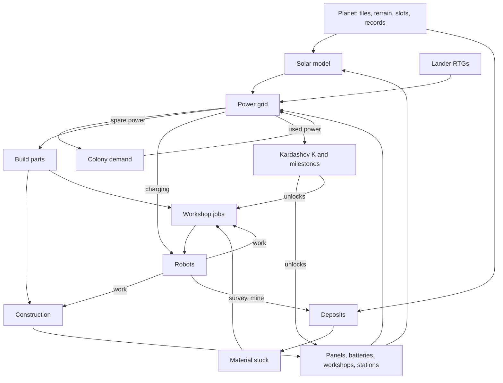

# Repository audit

**Audited:** `origin/main` at `abe383c` (merge of PR #58), on 2026-11-12.
**Method:** every file under `Assets/_Project`, `docs/`, `tools/`, `prototypes/` and the project settings was listed; the files named in this report were read; the layering claims were checked with searches; the simulation tests were compiled and run outside Unity.
**Purpose:** say what exists, so that the architecture and roadmap documents describe the real project and not the intended one.

This is a snapshot. Living status belongs in [`feature-registry.md`](feature-registry.md) and [`known-issues.md`](known-issues.md).

How to read the status words:

| Word | Meaning |
| --- | --- |
| **Implemented** | Code is on `main` and wired into the running game. |
| **Partial** | On `main`, but part of the intended system is missing or is a placeholder. |
| **Library only** | Code and tests are on `main`, but nothing in the game calls it. |
| **Unmerged** | Exists on a branch or in a working copy, not on `main`. |
| **Planned** | Written down in a design document; no code. |
| **Absent** | Named in the game vision; nothing in the repository. |

## 1. Summary

- The project is a working vertical slice, not a prototype shell: land on one of five planets, place solar panels, store power, grow the colony, run robots that build, survey, mine and manufacture, and climb planet-scale Kardashev milestones.
- The Simulation / Presentation split is real and enforced by the compiler. No file under `Scripts/Simulation` references `UnityEngine`.
- 753 simulation tests pass on `main` when compiled outside Unity with .NET 9 and NUnit 3.14 (run on 2026-11-12). The Unity Test Runner was not run for this audit.
- The solar model is the only system verified against outside references (pvlib and NASA POWER). The robot, resource and manufacturing systems run on values marked `TBD` in code.
- Game content other than planets is written as C# constants.
- One class, `StubPlanetSimulation` (1,356 lines), orchestrates every system. It is the main structural risk for adding more systems.
- Before this audit the repository had no vision document, no feature registry, no roadmap and no record of technical decisions. The original design document that the physics report reviews is not in the repository.

## 2. What was inspected

| Area | Inspected | Not inspected |
| --- | --- | --- |
| Source | All 128 `.cs` files listed with line counts; interface, state, orchestrator, energy, resources, robot catalogue, manufacturing, planet record, Kardashev and the runner read in full or in large part | Most Presentation views were read only by outline; shaders and materials were listed, not read |
| Tests | All 40 test files listed and counted; compiled and run outside Unity | Not run inside the Unity Test Runner |
| Documentation | `CLAUDE.md`, `CONTRIBUTING.md`, `docs/simulation-interface.md`, both workforce design documents, the headings and fix list of `docs/physics/physics-verification.md`, the tool READMEs | `docs/physics/explainer-th.md` and the five research notes were read by heading only |
| Data | `Assets/_Project/Data/Planets/planets.json` (structure, five planets) | `tools/exoplanets/cache/pscomppars.csv` |
| GitHub | All issues (14, all closed), all pull requests (#1–#61), all remote branches compared with `main` | Project boards, releases and repository settings |
| Unity project | `Packages/manifest.json`, `ProjectVersion.txt`, build scene list, assembly definitions | The scene file `Assets/Scenes/Main.unity` (never read as text, by project rule) |

## 3. Project facts

| Fact | Value | Where |
| --- | --- | --- |
| Engine | Unity `6000.6.8f1` | `ProjectSettings/ProjectVersion.txt` |
| Render pipeline | Built-in (no URP or HDRP package); five custom shaders | `Packages/manifest.json`, `Assets/_Project/Shaders` |
| UI | UI Toolkit (`.uxml`, `.uss`, one `.tss` theme) | `Assets/_Project/UI` |
| Input | Legacy `Input.GetKey` calls; the Input System package is not installed | `Scripts/Presentation` |
| Packages beyond Unity modules | Unity Test Framework 1.8.0, IDE packages, `com.coplaydev.unity-mcp` tracking its `main` branch | `Packages/manifest.json` |
| Scenes | One: `Assets/Scenes/Main.unity`, built by an editor script | `Scripts/Editor/MainSceneSetup.cs` |
| Assemblies | `KardashevAscent.Simulation` (`noEngineReferences`, no references), `.Presentation` (references Simulation), `.Editor` (references both), `.Simulation.Tests` (references Simulation only, EditMode) | the four `.asmdef` files |
| Code size | 16,746 lines in `Scripts`, 6,714 lines in `Tests` | `wc -l` |
| Continuous integration | None (no `.github` folder) | repository root |
| Languages in documents | Thai: `CLAUDE.md`, `CONTRIBUTING.md`, `simulation-interface.md`, the physics documents, tool READMEs. English: `docs/design/*`, all code comments and UI text | — |

## 4. System inventory

### 4.1 Simulation (`Assets/_Project/Scripts/Simulation`, namespace `KardashevAscent.Simulation.*`)

| System | Status | Code | Tests | Notes |
| --- | --- | --- | --- | --- |
| Planet tiling | Implemented | `Planet/HexSphere.cs`, `PlanetFrame.cs` | `Planet/HexSphereTests.cs` | Hex sphere with 12 pentagons; tile ids are indices; neighbours known |
| Terrain | Implemented | `Planet/PlanetSurface.cs`, `Noise3D.cs` | `Planet/PlanetLookTests.cs` | Ten terrain types from seeded noise and planet flags. No plate tectonics, no climate model; terrain is the only geography |
| Building slots | Implemented | `Planet/TileSite.cs`, `Game/BuildingFootprints.cs` | `TileSiteTests.cs`, `FootprintTests.cs` | 61 slots on a hexagonal tile; buildings may cover several slots |
| Planet records | Implemented | `Planet/PlanetRecord.cs`; data in `Data/Planets/planets.json` | `PlanetRecordTests.cs`, `PlanetChoiceTests.cs` | Five planets (one hand-made, four from the NASA Exoplanet Archive). Every value carries a provenance label: `nasa`, `derived` or `assumed` |
| Solar model | Implemented and verified | `Solar/*` (19 files) | `Solar/*` (169 test attributes), reference values generated from pvlib | Orbit, sun position, air mass, direct and diffuse light, panel temperature, spectral match by star temperature, annual and monthly yield, energy payback, binary stars, tidally locked worlds |
| Clouds | Partial | `Climate/CloudClimate.cs`, generated `CloudClimateTable.cs` | `CloudClimateTests.cs` | Earth's cloud climatology from NASA POWER, used only for planets flagged `clouds: earth` |
| Waste heat | Library only | `Climate/WasteHeat.cs` | `WasteHeatTests.cs` | Full T⁴ balance with a list of energy source kinds. Nothing in the game calls it |
| Power grid | Implemented | `Energy/PowerGrid.cs`, `Battery.cs`, `Rtg.cs` | `PowerGridTests.cs` | One bus per colony: solar and RTG generation, demand, priority and dock loads for robots, battery, curtailment. No distance, no transmission loss |
| Colony demand | Implemented (game rule) | `Energy/ColonyDemand.cs` | `ColonyDemandTests.cs` | Demand grows toward 85 % of average generation; brownouts hold it back |
| Kardashev scale | Implemented | `Civilization/Kardashev.cs` | `KardashevTests.cs`, `MilestoneTests.cs`, `KardashevMeterTests.cs` | Absolute K, per-planet K (a game index) and ten milestones |
| Progression | Partial | `Game/PanelTiers.cs`, `Robots/Manufacturing.cs` (`RobotTech`) | `PanelTierTests.cs`, `ManufacturingTests.cs` | Milestones are the only unlock mechanism. There is no technology or research system |
| Construction | Implemented | `Game/Construction.cs` | `ConstructionTests.cs` | Buildings cost "build parts" counted in Wh, made from spare power. Sites progress only while a robot works on them |
| Buildings | Partial | `BuildingType` in `Game/IPlanetSimulation.cs` | spread across game tests | Four types: solar panel, battery yard, Robot Workshop, charging station |
| Robots and groups | Implemented | `Robots/Workforce.cs` (1,182 lines), `Robot.cs`, `RobotGroup.cs`, `WorkTask.cs` | `WorkforceTests.cs`, `ProgramTests.cs`, `RobotWorkTests.cs` | Six robot kinds (Transport cannot be made), four operating programs, five priority levels, overrides |
| Robot data | Implemented, placeholder values | `Robots/RobotCatalog.cs`, `RobotSpecs.cs` | `CatalogTests.cs` | Attributes and a compatibility table in one static class. 25 `TBD` markers in `RobotSpecs.cs` alone |
| Task records and scheduling | Implemented | `Robots/TaskBook.cs`, scoring in `Workforce.Assign` | `SchedulerTests.cs` | Task states, reservations, deterministic tie-breaks |
| Facility staffing | Partial | `Robots/FacilityStaffing.cs` | `StaffingTests.cs` | Only the Workshop uses staff. Panels and battery yards wait for decision Q2 |
| Robot energy and condition | Implemented, partly placeholder | `Robots/RobotBattery.cs`, `RobotUpkeep.cs` | `RobotUpkeepTests.cs`, `BatteryV2Tests.cs` | Battery size is sourced (Perseverance). Depth-of-discharge exponent and 0 % damage are unsourced `TBD` values |
| Movement | Implemented | `Robots/RouteFinder.cs` | `MovementTests.cs` | Routes over land tiles, pace by terrain, drive power proportional to gravity |
| Resources | Partial | `Resources/Material.cs`, `DepositMap.cs` | `ResourceTests.cs` | Seven materials as an enum, in kg. Deposits by terrain and star metallicity. One colony-wide stock: no storage sites, no transport |
| Manufacturing | Partial | `Robots/Manufacturing.cs` | `ManufacturingTests.cs` | Workshop jobs: robots, four upgrade modules, two refined substitutes. Recipes are C# constants |
| Sky knowledge | Implemented | `Solar/SkyNotebook.cs`, `SkyMath.cs`, `SkyReport.cs` | `SkyNotebookTests.cs`, `SkyMathTests.cs` | The colony must measure its sky before the game offers best-angle advice |
| Ground knowledge | Implemented | survey orders in the orchestrator, `DepositMap.IsSurveyed` | `ResourceTests.cs` | Deposits are hidden until a robot surveys the tile |
| Save state | Implemented | `Game/SimulationState.cs` (version 16), `Robots/WorkforceState.cs` | `SaveStateTests.cs` plus a migration test in most feature test files | One versioned object; older versions load with defaults |
| Orchestration | Implemented | `Game/StubPlanetSimulation.cs` (1,356 lines), `Game/IPlanetSimulation.cs` (about 100 members) | `PlanetSimulationTests.cs` | Fixed sub-steps of at most 0.25 h |

### 4.2 Presentation (`Assets/_Project/Scripts/Presentation`)

| Part | Code | Notes |
| --- | --- | --- |
| Simulation host | `Game/SimulationRunner.cs`, `SaveGameController.cs`, `PlanetDNA.cs` | Builds the simulation for the chosen planet, ticks it every frame, saves to one JSON file with `JsonUtility` (F5 / F9) |
| Planet and site views | `Planet/PlanetView.cs`, `PlanetMeshBuilder.cs`, `SiteView.cs`, `TilePicker.cs`, `PanelPlacer.cs` (908 lines), visuals for panels, batteries and robots | Robot models are visual only; the simulation never reads them |
| Overlays | `Planet/LightPotentialOverlay.cs` (M), `GodMode.cs` (F10), `SkyView.cs` (V) | God mode shows every tile's ground, including unsurveyed tiles |
| Camera | `Camera/OrbitCamera.cs`, `CursorLight.cs` (F) | — |
| UI panels | `UI/HudView.cs`, `PanelsView.cs`, `TileInfoView.cs`, `ColonyView.cs` (C), `WorkforceView.cs` (G), `PlanetChooserView.cs` (L), `SkyPanelView.cs`, `HintsView.cs` | A permanent HUD plus panels opened by key |
| Editor tools | `Editor/MainSceneSetup.cs`, `PlanetImporter.cs`, `BuildWindows.cs` | Menu "Kardashev Ascent": Set Up Scene, Import Planets, Build Windows |

Presentation has no automated tests.

### 4.3 Tools and prototypes

| Tool | Purpose | Output |
| --- | --- | --- |
| `prototypes/solar/` (Python) | Reference solar model, compared against pvlib | Generates `Tests/EditMode/Solar/PvlibReference.cs` |
| `tools/exoplanets/` (Python, with unit tests) | Fetches the NASA Exoplanet Archive and converts units | Generates `Assets/_Project/Data/Planets/planets.json` from the hand-edited `tools/exoplanets/planets.json` |
| `tools/nasa_power/` (Python) | Fetches NASA POWER cloud climatology | Generates `Simulation/Climate/CloudClimateTable.cs` |
| `tools/setup-git.*` | Git LFS and Unity Smart Merge setup | — |

## 5. Work that is not on `main`

| Where | What | State |
| --- | --- | --- |
| `origin/feature/building-footprints`, 9 commits ahead of `main` | One window per game system with a tab bar; re-angling a built panel as a robot task; solar parameters as estimates with a spread that research robots measure through reasoning puzzles (stages B–F, `docs/design/solar-measurements.md`); the colony network (workforce v2 stage E, first part) | Pushed, no open pull request. PR #61 merged an earlier state of this branch |
| Working copy of the main checkout, branch `feature/resources-industrial-production-foundation` | Uncommitted `Resources/IndustrialProduction.cs` with tests: material phases, storage classes, production blockers (missing input, electricity, process heat, cooling, storage) | Seen on 2026-11-12, not pushed, author not recorded. Contents not reviewed |
| `origin/light-experiment` | The director's flashlight experiment, one commit ahead of `main` | The flashlight feature itself reached `main` through PR #40 from another branch |

There are no open issues and no open pull requests.

## 6. Planned in documents, not built

| Item | Source |
| --- | --- |
| Workforce v2 stages E (rest), F, G, H: AI levels, memory and sync, colony computing; component tiers; inspection UI; orchestrator split and performance budget | `docs/design/robotic-workforce-v2-audit.md` |
| Transportation and logistics, robot rescue | Deferred by the workforce specification |
| Other energy sources, with corrected numbers | `docs/physics/physics-verification.md` (P2 list), `docs/physics/notes/energy_sources.md` |
| Procedural ore rules that need plate tectonics, closed basins and permanent shadow | `docs/physics/notes/geology_resources.md` |
| Greenhouse offset for air temperature | `physics-verification.md`, P1 item 14 |

## 7. In the game vision, absent from the repository

Atmosphere and climate simulation beyond clear-sky optics and Earth's clouds; per-tile temperature and pressure; subsurface exploration; storage and logistics; chemical processing, byproducts, waste and recycling; every energy source except photovoltaics and the lander's RTGs; transmission losses; thermal management in play; all water infrastructure; research laboratories, experiments and unknown substances; reports and a colony knowledge database; the AI scientific assistant; technology trees; multiple colonies; interplanetary transport; orbital engineering and megastructures; natural disasters and other events (stellar flares exist only as a wear rate on robots).

## 8. Overlap and duplication

| Finding | Detail |
| --- | --- |
| Two files named `planets.json` | `tools/exoplanets/planets.json` is the hand-edited input; `Assets/_Project/Data/Planets/planets.json` is generated. The names invite editing the wrong one |
| Three unlock tables | `PanelTiers.All`, `RobotTech.UnlockMilestone` (three overloads) and `RobotCatalog.Capabilities` each map milestones to unlocks |
| Two battery models | `Energy/Battery.cs` (grid) and `Robots/RobotBattery.cs` (robot, with ageing). Intentional reuse was planned; check before adding a third |
| Two robot data classes | `RobotSpecs` (energy and wear numbers) and `RobotCatalog` (attributes and compatibility). The v2 audit planned one catalogue |
| Building bookkeeping repeated per type | The orchestrator keeps a separate set and counter for panels, batteries, workshops and stations |

## 9. Architecture findings

1. **The orchestrator is a god object.** `StubPlanetSimulation` owns the grid, construction, robots, resources, manufacturing, footprints, milestones, history and save and restore. Its name says "stub", but it is the only implementation. The workforce plan already lists the split as stage H and risk R2.
2. **The interface is wide and exposes mutable objects.** `IPlanetSimulation` has about 100 members and hands out `Workforce`, `DepositMap`, `MaterialStock`, `PowerHistory` and `SkyNotebook` directly, so Presentation can change simulation state without a command.
3. **Namespace cycles inside the Simulation assembly:** `Planet` ↔ `Solar`, `Planet` ↔ `Resources`, `Robots` ↔ `Game`. They compile because it is one assembly, and they block any later split into assemblies.
4. **One planet is the whole world.** There is no colony or civilization object above the planet simulation; the save file is one planet.
5. **Content is code.** Materials, building types, recipes, robot kinds, panel tiers and unlocks are enums and constants.
6. **Saves store enums as integers** (`JsonUtility`). Reordering or inserting into `Material`, `BuildingType`, `TaskKind`, `RobotKind` and others corrupts old saves silently.
7. **Actual and known state are mixed.** Surveyed tiles and the sky notebook model "what the colony knows", but the HUD and panels read actual simulation state directly.
8. **No conservation tests.** No test asserts that energy or mass balances over a run.
9. **No performance or determinism tests** for the whole simulation (planned as stage H).
10. **Presentation depends on one concrete class in one place** (`SimulationRunner` constructs `StubPlanetSimulation`). This is acceptable and easy to change.

None of these stops current work. The migration plan is in [`../architecture/system-architecture.md`](../architecture/system-architecture.md), section 6.

## 10. Documentation findings

- `docs/simulation-interface.md` is the contract document but stops at the colony overview; robots, resources, manufacturing, footprints and save versions 4–16 are missing from it.
- `docs/design/robotic-workforce-v2-audit.md` says that `main` is at `274f999` and that nothing in the workforce stack is merged; PRs #50–#61 are all merged.
- The physics report lists sources that could not be reached when it was written and values that are inferred, not sourced (its last section).
- The design document that the physics report reviews is referred to as "เอกสารดีไซน์" and is not in the repository, so its content could not be checked.
- `CLAUDE.md` describes the structure and four rules; it had no reading order, no workflow and no status tracking.

## 11. Dependencies between systems (as built)

Every arrow passes through `StubPlanetSimulation.Step`; the systems do not hold references to each other, with one exception: `Workforce` and `RobotUpkeep` are handed the grid results, the construction queue and the material stock as arguments.
