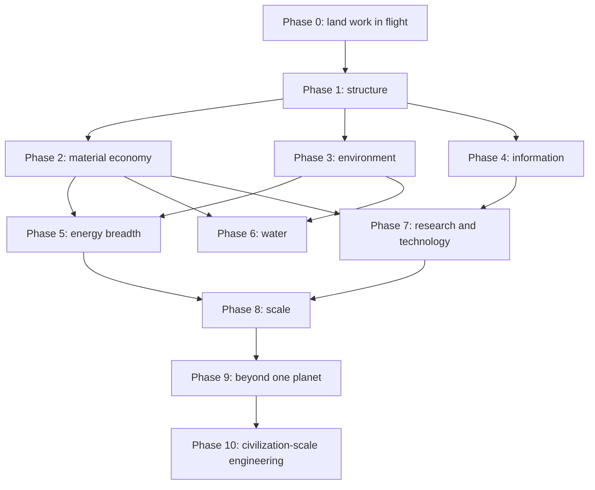

# Roadmap

The order in which to build, set by what depends on what. It has no dates: the director sets priorities and dates.

Everything here is a **proposed sequence**. A phase starting does not make its features CONFIRMED; each feature still needs its registry entry and, for anything new to the game, the director's decision.

Identifiers refer to [`feature-registry.md`](feature-registry.md) (features, open questions), [`../architecture/system-architecture.md`](../architecture/system-architecture.md) (M steps), [`../architecture/data-architecture.md`](../architecture/data-architecture.md) (D steps) and [`../architecture/information-architecture.md`](../architecture/information-architecture.md) (I steps).

## 1. Where the project stands

**Foundations that exist:** the two-layer architecture; a verified solar model; planets from real data; grid, storage and demand; construction; the Kardashev progression; a deep robotic workforce; survey, mining and a first workshop; versioned saves; 753 passing simulation tests.

**Foundations that are missing:**

| Missing | Blocks |
| --- | --- |
| An orchestrator that can take more systems (M1) | Every new colony system |
| Content definitions outside code (D1–D3) | Industry, logistics, water, more buildings |
| Inventories per place | Storage, logistics, transport robots, interplanetary trade |
| An environment model per tile | Other energy sources, thermal management, equipment limits, events |
| An observation and knowledge model (I2, I3) | Reports, research, the AI assistant, minimal interface |
| A technology model | Research as progression |
| A layer above one planet (M9) | Several colonies and planets |
| Conservation, determinism and performance tests | Trust in every later system |
| Continuous integration | Several AI developers working at once |

## 2. Dependency map

Phases 2, 3 and 4 can run side by side once phase 1 is done.

## 3. Phases

### Phase 0: land the work in flight

| Milestone | Detail | Kind |
| --- | --- | --- |
| Merge or close `feature/building-footprints` | Solar measurements, re-angling by robot, system windows, colony network | Gameplay |
| Decide the industrial-production work (OQ-10) | Specification, then a pull request, or set it aside | Design |
| Bring `docs/simulation-interface.md` up to the current interface | Robots, resources, manufacturing, footprints, save versions | Documentation |
| Continuous integration | **Done:** runs `tools/simtests`, the layer check and the Python tests on every pull request | Infrastructure |

Exit: no unmerged feature branch older than the newest merge; the interface document matches the code.

### Phase 1: structure (partly done 2026-11-13)

Done: orchestrator split into partial files and renamed (M1 first half, M2), namespace cycles broken (M3), energy ledger and determinism tests (M8), continuous integration, layer check. Also done: building definitions table (M6 part), role interfaces for readouts, events and saves (M4 part). Still to do: M1 second half, rest of M4, M5, M6 (unlock table, robot catalogue), M7, mass ledger, performance budget, workforce stages E–G.

| Milestone | Detail | Kind |
| --- | --- | --- |
| Split the orchestrator (M1, M2) | Same behaviour, same saves, smaller files | Core simulation |
| Break namespace cycles (M3) | | Core simulation |
| Role interfaces and read models (M4, M5) | | Core simulation |
| One unlock table, one robot catalogue, building definitions (M6, D2, D5, D6) | | Data |
| Ledger tests (M8), determinism test, performance budget (workforce stage H) | | Verification, performance |
| Finish workforce stages E–G | Already designed and CONFIRMED as scope | Gameplay |

Exit: adding a building type or a colony system touches a definition, one system class and the orchestrator's wiring, and nothing else.

### Phase 2: material economy

Needs decisions OQ-3 and OQ-8.

| Milestone | Detail | Kind |
| --- | --- | --- |
| Material definitions (D1), recipes with mass and energy balance (D3), string ids in saves (D4) | | Data |
| Deposits with amounts; depletion | RS-07 | Core simulation |
| Inventories per place; storage buildings | RS-08 | Core simulation |
| Transfers as robot tasks; transport robots get work | RB-14 | Gameplay |
| Industrial facilities running recipes; byproducts and waste | RS-09 | Gameplay |
| Recycling | RS-09 | Gameplay |

Exit: mass balances over a run; a production chain of at least three steps works end to end.

### Phase 3: environment

| Milestone | Detail | Kind |
| --- | --- | --- |
| Environment query per tile and time: temperature, pressure, and what the planet record can support | PL-07 | Core simulation |
| Sources and verification for each field | Scientific standards §5 | Verification |
| Equipment reads the environment: panels, batteries, robots | Replaces the single air temperature | Core simulation |
| Waste heat connected to the planet (EN-09) and a heat ledger | EN-12 | Core simulation |
| Named loads and sources on the grid (M7) | | Core simulation |

Exit: two tiles on one planet differ in a way that changes what the player builds there.

### Phase 4: information

Needs decisions OQ-1 and OQ-4.

| Milestone | Detail | Kind |
| --- | --- | --- |
| Observation record and knowledge store (I2, I3) | IN-04 | Core simulation |
| Reports (I4) | IN-05 | Gameplay, presentation |
| Panels move from actual to known state (I5) | UI-05 | Presentation |
| History beyond power | IN-05 | Core simulation |

Exit: the player can play a session from reports and inspections, and every number on screen has a unit, a source and an age.

### Phase 5: energy breadth

Needs phase 2 (materials to build with) and phase 3 (the environment each source depends on), and decision OQ-11.

| Milestone | Detail | Kind |
| --- | --- | --- |
| A common contract for energy sources | Architecture §5.2 | Core simulation |
| A second energy source, verified before it is coded | EN-11 | Verification, gameplay |
| Distribution and transmission losses | EN-10 | Core simulation |
| Further sources, one at a time, each with its verification | EN-11 | Gameplay |

Exit: the best energy mix differs by planet for physical reasons the player can inspect.

### Phase 6: water

Needs phases 2 and 3. All of RS-11: extraction, ice mining, desalination, storage, distribution, industrial use, cooling, electrolysis. Not designed.

### Phase 7: research and technology

Needs phases 2 and 4, and decision OQ-5.

| Milestone | Detail | Kind |
| --- | --- | --- |
| A technology model that the unlock table reads | CO-09 | Core simulation |
| Samples, experiments, laboratories, failure | IN-06 | Gameplay |
| Unknown substances with consistent property sheets | Scientific standards §3 | Design, verification |
| Scientist consultation; the AI assistant | IN-07, IN-08 | Presentation, integration |
| Events and anomalies | IN-09 | Gameplay |

### Phase 8: scale

| Milestone | Detail | Kind |
| --- | --- | --- |
| Aggregate simulation of background work | RB-13 | Performance |
| Budgets for thousands of robots and buildings | | Performance |
| Late milestones reachable in play | Balance pass (OQ-12) | Gameplay |

### Phase 9: beyond one planet

Needs decision OQ-2 and architecture step M9. Several colonies, several planets, interplanetary transport, industrial specialisation (CO-10). Not designed.

### Phase 10: civilization-scale engineering

Orbital engineering, megastructures, stellar energy collection, Kardashev progression past Type I (CO-11, EN-13). Not designed. Content here is speculative science and is labelled as such.

## 4. Milestones by kind

| Kind | In order |
| --- | --- |
| Core simulation | Orchestrator split → definitions → inventories → environment → knowledge store → source contract → technology model → civilization layer |
| Gameplay | Workforce E–G → production chains → second energy source → water → research → several planets → megastructures |
| Presentation | Interface document current → reports → panels on known state → inspection views → consultation |
| Scientific verification | Close the gaps listed in scientific standards §8 → verify each environment field → verify each energy source before coding it → property sheets for hypothetical materials |
| Performance | Determinism test → step budget → aggregate simulation → large-colony budgets |

## 5. What not to do yet

- Do not start a second energy source before phases 2 and 3 give it materials and an environment.
- Do not build logistics on the single colony-wide stock.
- Do not design megastructures while one planet is unfinished.
- Do not add an assembly, a framework or a pattern that no current feature needs.
- Do not balance placeholder numbers one at a time; balance is one pass with the director (OQ-12).
