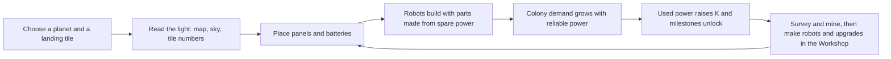

# Master game design

This is the top-level design of Kardashev Ascent: the loop, the systems and how far each is decided. It points to detailed specifications instead of repeating them.

**How to read the labels.** Every statement about the game's design carries one of the four design statuses defined in [`../development/feature-registry.md`](../development/feature-registry.md): CONFIRMED, PROPOSED, REJECTED, FUTURE. A statement with no label describes what the code on `main` does today.

**Who decides.** The game director decides game design. An AI developer may add a PROPOSED entry or an open question; it may not change a label to CONFIRMED.

## 1. The player's role

The player directs a robotic expedition on a planet. The player chooses where to land, what to build and what the robots should care about. Robots do the work.

## 2. Gameplay loop

### 2.1 The loop as built today

- **Moment to moment:** pick tiles, set panel angles, place buildings, set robot priorities.
- **Minutes:** survive the night without a brownout, clear the construction queue, keep robots charged and repaired.
- **Session:** reach the next milestone, which is ten times the power of the one before.
- **End of the current game:** milestone 10, the planet's Type I target.

### 2.2 The intended long loop (FUTURE)

Explore → discover → extract → process → manufacture → build infrastructure → research what was found → expand to the next site, the next planet, the next scale. The director has set this direction; the mechanics of each step beyond what section 3 marks as built are not designed.

## 3. Systems

Design status and implementation status are separate. A FUTURE system with no code is still a direction the architecture must leave room for.

### 3.1 Planetary systems

| Topic | Design status | Built today |
| --- | --- | --- |
| Planets from real data with labelled provenance | CONFIRMED (PR #43) | Five planets; values labelled NASA, derived or assumed |
| Hex-tile geography and terrain | CONFIRMED (PR #3, #45) | Ten terrain types from seeded noise |
| Geological composition | CONFIRMED in part (PR #52, #60) | Deposits of five mined materials by terrain and star metallicity |
| Gravity and orbit | CONFIRMED | Orbit drives the sun; gravity drives robot drive power |
| Atmosphere, climate, temperature and pressure | FUTURE | Clear-sky optics, one air temperature per planet, Earth's clouds on Earth-like planets |
| Environmental simulation | FUTURE | None |
| Subsurface exploration | FUTURE | None |

### 3.2 Robotic workforce

Detailed specification: [`../design/robotic-workforce.md`](../design/robotic-workforce.md) and [`../design/robotic-workforce-v2-audit.md`](../design/robotic-workforce-v2-audit.md).

| Topic | Design status | Built today |
| --- | --- | --- |
| General and specialised robots, groups, programs, priorities, overrides | CONFIRMED (decisions approved 2026-11-08) | Built |
| Task scheduling, reservations, facility staffing | CONFIRMED | Built; only the Workshop is staffed |
| Batteries, charging, wear, maintenance | CONFIRMED | Built with placeholder numbers |
| Movement over tiles | CONFIRMED | Built |
| Robot manufacturing and upgrades | CONFIRMED | Built with placeholder recipes |
| Network, disconnection and synchronisation | CONFIRMED (Q1, 2026-11-08) | Unmerged first part |
| AI levels, memory, distributed knowledge, colony computing | CONFIRMED as scope of stage E; details open | Not built |
| Transport robots and logistics | FUTURE | Transport robots cannot be made |
| Robot rescue | FUTURE | Stranded robots wait |

### 3.3 Resources and industry

| Topic | Design status | Built today |
| --- | --- | --- |
| Discovery by survey | CONFIRMED (PR #52) | Built |
| Mining | CONFIRMED | Built; one colony-wide stock in kg |
| Substitute materials (aluminium for copper, sodium for lithium) | CONFIRMED | Built |
| Material composition and purity | FUTURE | Deposits have a grade; mined material has no purity |
| Storage and logistics | FUTURE | None |
| Chemical processing, production chains, byproducts, waste, recycling | FUTURE | Two refining jobs in the Workshop; uncommitted foundation work seen locally |
| Environmental effects of industry | FUTURE | None |

### 3.4 Energy infrastructure

Energy is a defining pillar. Only the first two rows are built.

| Topic | Design status | Built today |
| --- | --- | --- |
| Solar photovoltaics | CONFIRMED | Built and verified against pvlib |
| Storage in batteries | CONFIRMED | Built: one colony battery, expanded by battery yards |
| Radioisotope generators on the lander | CONFIRMED | Built |
| Power distribution and transmission losses | FUTURE | One lossless bus per colony |
| Nuclear, geothermal, tidal, wave, ocean thermal, floating solar, advanced sources | FUTURE | None. The physics report has checked numbers for several |
| Thermal management and waste heat | FUTURE | A tested waste-heat model exists and is not used |
| Planetary energy engineering, stellar collection, megastructures | FUTURE | None |

### 3.5 Water infrastructure

All FUTURE: extraction, desalination, ice mining, storage, distribution, industrial use, cooling, electrolysis, ocean infrastructure. Today water ice is one of the mined materials and nothing consumes water as a process input except one upgrade recipe.

### 3.6 Scientific research

| Topic | Design status | Built today |
| --- | --- | --- |
| Measuring the sky to earn advice | CONFIRMED (PR #48) | Built |
| Measuring solar parameters with reasoning puzzles | CONFIRMED in chat on 2026-11-09 per `docs/design/solar-measurements.md` | Unmerged |
| Unknown substances, samples, experiments, laboratories, models, failure, scientist consultation | FUTURE | None |

### 3.7 Information and AI

The principle is CONFIRMED (pillar 8): the player learns through observations, reports and inspections, and nothing knows what has not been observed or communicated. The mechanics are FUTURE. See [`../architecture/information-architecture.md`](../architecture/information-architecture.md) for the conventions and for how far the current interface is from the principle.

| Topic | Design status | Built today |
| --- | --- | --- |
| Hidden ground until surveyed | CONFIRMED | Built |
| Reports (operational, environmental, scientific), colony knowledge database, history | FUTURE | A seven-day power history |
| Local AI scientific assistant, optional online references | FUTURE | None |

### 3.8 Civilization progression

| Topic | Design status | Built today |
| --- | --- | --- |
| Kardashev scale shown as absolute K beside a per-planet index | CONFIRMED (PR #42) | Built |
| Milestones every 0.1 of planet K | CONFIRMED (PR #44) | Built |
| Unlocks by milestone | CONFIRMED as the current rule; whether research replaces or joins it is open (OQ-5) | Built |
| Technology development, multiple colonies, interplanetary transport, specialisation, orbital engineering, megastructures | FUTURE | None |

### 3.9 Exploration and events

All FUTURE: anomalies, disasters, unusual phenomena, rare discoveries, speculative events. Stellar flares on red-dwarf planets exist only as extra robot wear.

## 4. Rules that hold across systems

These are CONFIRMED by the pillars and by merged work.

1. Energy and matter are conserved. A game rule may set a price or a share; it may not create energy or mass.
2. Every number shown to the player has a unit and, where it is a property of the world, a source label.
3. A value that science cannot yet measure is shown as assumed, not as fact.
4. Game rules that are not physics are named as game rules in code and in the interface (for example the per-planet Type I target, colony growth and the 1 % on-site share of build cost).
5. Robots act without orders. A player order overrides automation, and automation records why it reassigned a robot.

Where today's code falls short of rule 1 (deposits never run out; refining drops the leftover mass) is listed in [`../development/known-issues.md`](../development/known-issues.md).

## 5. Open design questions

The full list with owners is in the feature registry. The ones that shape the architecture most:

- **OQ-1.** How much permanent interface stays, given pillar 8?
- **OQ-2.** Does the game stay one colony per planet, and when do several planets run at once?
- **OQ-3.** Are "build parts" in Wh the lasting construction currency, or do materials replace them?
- **OQ-4.** What may the player see that the colony has not observed?
- **OQ-5.** Do milestones remain the unlock mechanism once research exists?

## 6. Detailed specifications

Index and template: [`../design/README.md`](../design/README.md).
